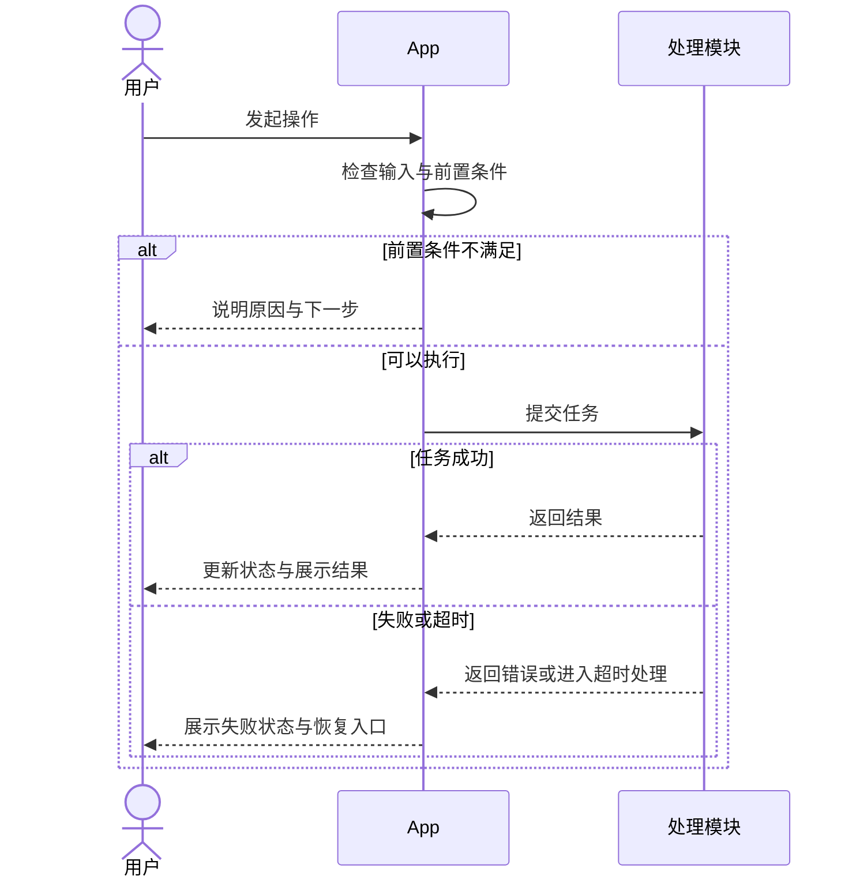

# PRD 输出模板

按下面八个章节生成 PRD。替换占位内容，保留“建议方案”“待确认”标记；不适用的章节说明原因。不要把示例流程当成已确认业务规则。

## 1. 需求背景

- 业务目标与用户痛点：写明目标用户、场景、现有问题及证据。
- 范围：写明本期覆盖内容与明确排除项。
- 预期收益：给出指标定义、基线、目标、统计周期与来源。无数值依据时写明计算方法与“目标值待确认”。

## 2. 核心功能

| 功能 | 优先级 | 描述 |
| --- | --- | --- |
| F-01 功能名称 | 必须 / 应该 / 可选，待确认时注明 | 入口、前置条件、具体行为、结果、范围 |

## 3. 交互流程

写明参与方、关键状态、取消或返回路径。使用 Mermaid 时序图，包含至少一个适用的异常分支。以下仅为结构示例，参与方可替换为本地模块：

## 4. 数据设计

| 对象 / 字段 | 类型 | 必填 / 默认值 | 约束 | 来源 / 写入方 | 生命周期 |
| --- | --- | --- | --- | --- | --- |
| 待填写 | 待填写 | 待填写 | 唯一性、范围或状态值 | 待填写 | 保存位置、保留与删除 |

说明主要查询、相应索引建议与依据；写明数据从输入、处理、存储到展示和删除的流向，以及失败时的回滚或补偿方式。

## 5. 接口定义

对每个网络接口或本地模块契约说明名称、调用方、前置条件与职责。

| 方向 | 字段 | 类型 | 必填 | 含义与约束 |
| --- | --- | --- | --- | --- |
| 入参 / 出参 | 待填写 | 待填写 | 待填写 | 待填写 |

| 错误码或错误类型 | 触发条件 | 调用方处理 | 用户提示 | 是否可重试 |
| --- | --- | --- | --- | --- |
| 建议值须注明 | 待填写 | 待填写 | 待填写 | 条件与限制 |

补充超时、取消、幂等、重复调用与状态变更规则；未确定的契约标“建议方案 / 待确认”。

## 6. 异常场景处理

| 场景 | 触发条件 | 处理逻辑 | 用户提示 |
| --- | --- | --- | --- |
| 关联问题或场景编号 | 可判定条件 | 状态更新、数据处理、恢复或降级 | 可理解且有下一步的提示 |

## 7. 验收标准

| 编号 / 关联功能 | 类别 | 前置条件与测试数据 | 操作 / 测试方法 | 预期结果与量化阈值 |
| --- | --- | --- | --- | --- |
| AC-01 / F-01 | 功能 | 明确初始状态 | 可复现步骤 | 明确结果、数量或状态 |
| AC-02 / F-01 | 性能 | 设备、系统、数据规模、网络 | 样本量与统计口径 | 有依据的阈值；未确定则标待确认 |

覆盖成功、失败、边界和恢复。区分确认的验收要求与建议目标；缺少性能阈值时明确该项尚不可验收。

## 8. 技术风险

| 风险点 | 触发条件与影响 | 验证办法 | 降级方案 | 恢复条件 |
| --- | --- | --- | --- | --- |
| 能力、依赖、资源或一致性风险 | 待填写 | 文档核验、原型或实验 | 可继续使用的范围及提示 | 待填写 |

在八个章节之后，按 SKILL.md 的要求附自查清单与待确认事项表。清单勾选仅表示文档已覆盖，不代表产品已实现或测试通过。
